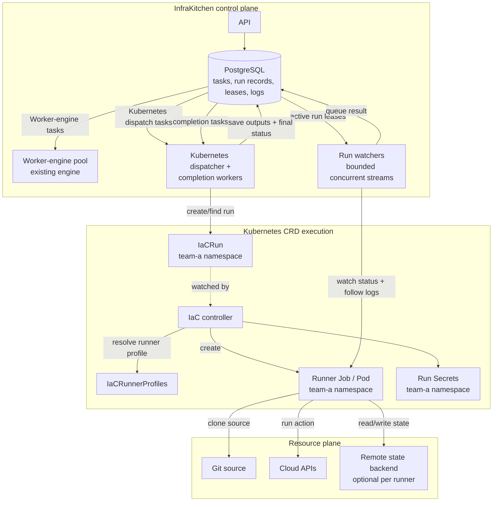

:::note[Roadmap proposal]
The Kubernetes CRD engine is a proposed roadmap feature, not an available InfraKitchen feature. It uses a generic run API so multiple IaC tools and custom runners can use the same InfraKitchen workflow. The API and runner contract are preliminary and may be refined as the design develops.
:::

## Proposal

InfraKitchen keeps defining the desired infrastructure, checking permissions, and tracking resource status. The Kubernetes CRD engine changes **where the action runs**, not what a resource means.

Instead of baking OpenTofu, Terraform, or another tool into one special controller, InfraKitchen submits a generic `IaCRun` object. The run points to an `IaCRunnerProfile`, which selects the runner implementation, version, and container image.

Examples of runner profiles:

| Runner profile  | What executes the run                          |
| --------------- | ---------------------------------------------- |
| `opentofu-1.x`  | OpenTofu runner image at the selected version  |
| `terraform-1.x` | Terraform runner image at the selected version |

A custom runner is not automatically compatible just because it is a container. It must follow the run contract: accept the declared inputs, perform the requested action, stream logs to stdout/stderr, return an exit status, and publish outputs in the agreed format.

## The components

| Component                      | Simple explanation                                                                                               | Where it runs                                                       |
| ------------------------------ | ---------------------------------------------------------------------------------------------------------------- | ------------------------------------------------------------------- |
| **InfraKitchen API**           | Checks access, saves the resource, and queues an action tagged for the selected engine.                          | InfraKitchen control plane                                          |
| **PostgreSQL**                 | Stores resources, task queue entries, external run records, watcher leases, logs, and completion tasks.          | InfraKitchen control plane                                          |
| **Worker-engine pool**         | Runs OpenTofu/Terraform directly for resources using the existing Worker engine.                                 | InfraKitchen                                                        |
| **Kubernetes dispatcher pool** | Claims Kubernetes-engine submission and completion tasks, creates/finds `IaCRun` objects, and updates resources. | InfraKitchen; separately scalable                                   |
| **Run watcher service**        | Leases active runs, follows status and pod logs, and queues a completion task when a run ends.                   | InfraKitchen; separately capacity-limited                           |
| **IaC controller**             | Watches `IaCRun` objects and creates an isolated runner Job using the referenced profile.                        | Kubernetes namespace `infrakitchen`                                 |
| **`IaCRun` CRD**               | One plan/apply/destroy action with a unique run ID, inputs, profile reference, and terminal result.              | Team namespace in the shared Kubernetes environment                 |
| **`IaCRunnerProfile` CRD**     | Admin-managed definition of runner type, tool/version, image, resources, security settings, and service account. | Cluster scope or namespace `infrakitchen`                           |
| **Runner Job and Pod**         | Executes one action using the selected tool or custom runner.                                                    | Team namespace in the shared Kubernetes environment                 |
| **Remote state backend**       | Stores durable IaC state when the runner uses a stateful IaC tool.                                               | Any backend supported by the runner and configured for the resource |
| **Kubernetes Secrets**         | Hold short-lived run credentials and sensitive inputs, with restricted access and ownership by the run.          | Team namespace in the shared Kubernetes environment                 |
| **InfraKitchen logs**          | Receive runner stdout/stderr and publish lines to the existing live-log subscription.                            | InfraKitchen PostgreSQL/UI                                          |

InfraKitchen data and IaC state are separate. PostgreSQL tracks the task and its logs. A runner that manages infrastructure also needs a backend to track those resources; a runner that only validates or scans configuration does not.

## Example: provision an application service

A team wants to provision an application service and its supporting cloud resources. They choose a resource template, a cloud integration, a runner profile, and any required state storage.

### Platform setup

Enabling the Kubernetes CRD engine in InfraKitchen should open a guided setup flow rather than immediately making the engine selectable. A platform administrator selects a supported Kubernetes environment and authorizes the required access. InfraKitchen then previews the changes and, after confirmation, can:

- Create the `infrakitchen` namespace if needed.
- Install or upgrade the generic controller, its CRDs, and the required namespace-scoped permissions.
- Register starter runner profiles, such as OpenTofu and Terraform, with their configured image references and resource limits. Kubernetes pulls the runner images when it starts Jobs.
- Check controller health, CRD readiness, permissions, and image availability, then show setup status in InfraKitchen.

After setup succeeds, the administrator can enable the engine for selected teams and control which runner profiles each team can use. InfraKitchen should allow administrators to configure the Kubernetes environments where runs can execute and the team namespaces each environment can use. Installation should use least-privilege access, show the requested permissions before applying changes, and support upgrades and removal.

### Resource configuration

The user selects:

- Engine: **Kubernetes CRD**
- Git repository, ref, and module directory
- Team namespace, such as `team-a`
- Runner profile, such as `opentofu-1.x` or `terraform-1.x`
- Cloud integration and runner credentials
- Remote state storage, if required by the selected runner
- Resource variables

The runner profile is the tool choice. For example, selecting `terraform-1.x` means the controller creates a Job using the Terraform runner image and version configured in that profile. Users can only select profiles enabled for their team/project.

### Dispatch, execution, and completion

1. **Route:** InfraKitchen queues the action for the Kubernetes dispatcher pool; it does not use a Worker-engine slot.
2. **Record intent:** A dispatcher stores a unique run ID and its resource/task, configured Kubernetes environment, namespace, action, and requested runner profile in PostgreSQL.
3. **Submit idempotently:** The dispatcher creates an `IaCRun` identified by that run ID. If it retries after a crash, it finds the existing run instead of duplicating infrastructure work. Once Kubernetes accepts the run, the dispatcher task ends and its worker slot is released.
4. **Execute:** The controller reads the `IaCRun`, resolves its runner profile, and creates an isolated Job in the team's namespace. The runner receives source, variables, credentials, backend configuration, and action according to the run contract.
5. **Monitor:** A watcher leases the run record, follows the Job's logs, and observes run status. It streams log lines into InfraKitchen's existing log storage and live UI subscription.
6. **Complete:** When the run succeeds or fails, the watcher queues a completion task. A worker from the same Kubernetes dispatcher pool that handled submission claims the completion task, collects outputs and final status, and updates the InfraKitchen resource. Completion is idempotent by run ID.

Plan, apply, and destroy are separate run actions. A plan can return a reviewable plan artifact; apply can reference the approved artifact so it applies exactly what was reviewed. The runner contract should also let non-IaC jobs return a result without Terraform-style state or outputs.

## Batch capacity and recovery

The two worker pools have different jobs:

- The **Worker-engine pool** runs IaC directly, as it does today.
- The **Kubernetes dispatcher pool** submits `IaCRun` objects. Once Kubernetes accepts a run, the dispatcher is free to take another task; it does not wait for the runner Job. This same pool later handles completion tasks.

The **watcher service** monitors submitted runs, streams logs, and queues a completion task when a run ends. Watchers have limited capacity. If they are all busy, runner Jobs can keep running, but log updates and completion handling may be delayed. Overall throughput also depends on Kubernetes Job capacity, provider limits, and runner resources.

If a watcher stops, its lease expires and another watcher can resume monitoring from the saved log position. A stable run ID lets InfraKitchen reconnect to the same run and avoid submitting or completing it twice.

If InfraKitchen becomes unavailable after Kubernetes accepts a run, the Job can continue. Monitoring and resource updates resume when InfraKitchen is back. If no dispatcher is available before submission, the task stays queued.

## Architecture overview

## Runner profile and security

Platform administrators create `IaCRunnerProfile` options. A profile chooses the runner tool and version, its image, and its resource and security limits. Users select from the profiles enabled for their team.

Each run gets only the inputs and credentials it needs. Use the Kubernetes environment's identity system when possible instead of storing long-lived cloud keys. If a credential must be stored as a Kubernetes Secret, create one for that run in its team namespace and remove it when it is no longer needed.

Limit the controller to creating run-related objects and Jobs in approved team namespaces. Give InfraKitchen only the access it needs to submit and read runs and read Job logs; it does not need cluster-admin access. Platform administrators configure these permissions as part of setup.

## Provider portability

The engine is designed to work with different Kubernetes environments and cloud providers. The Kubernetes environment runs the controller and runner Jobs; the selected runner uses its configured tools and credentials to work with the target cloud. These do not have to be provided by the same vendor.

To use a Kubernetes environment, InfraKitchen needs a supported way to connect to it and authorize the required operations. Each runner profile must also provide the right tool version, credentials, and state backend for the infrastructure it manages.

## Implementation status

The generic `IaCRun`, `IaCRunnerProfile`, and runner contract described here are a proposal and are not implemented yet. For InfraKitchen's current architecture, see [Architecture](../architecture).
