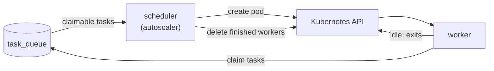

Besides static workers that run all the time, InfraKitchen can start task workers **on demand** when tasks are
waiting and remove them once they are idle.

On-demand workers are defined by **worker templates** (**Admin → Worker Templates**):

- **Provider** – **Kubernetes** (a pod per worker).
- **Configuration** – a Pod manifest and optional namespace.
- **Max workers** – how many workers of this template may run at once.
- **Idle timeout** – a worker exits after being idle this long.

## How a Template Is Chosen

Each task is routed to one template when it is queued:

1. The template selected on the resource or executor
2. The **global default** template
3. No template: the task runs on a **static worker**

Other tasks (syncs, tool downloads, workflows, scheduler jobs) use the default template, or static workers when no
default is set.

Routing is strict: a template's workers take only its tasks, and static workers take only tasks with no template.
A selected template that is disabled keeps its tasks: they wait until it is enabled again instead of running on
workers the resource did not choose. Queued tasks are re-routed whenever the default or a selection changes.

> **Upgrading:** if you run on-demand workers only, set a default template, otherwise tasks without a selection
> wait for a static worker.

### Global default

Set it with the **Global default** picker on **Admin → Worker Templates** or **Set default** on a template page.
Choosing **Static workers** clears it. The default template cannot be disabled.

### Selecting a template

Resources and executors have a **Worker Template** field; leave it empty to use the default. Templates differ in
what their workers can reach (e.g. a ServiceAccount), so choosing one needs access to worker templates; other users
always get the default. For resources, changing it needs approval like other fields. A template cannot be deleted
while resources or executors select it.

### Why a task is waiting

The task panel of a resource or executor shows the template a queued task waits for and why:

| Reason | Meaning |
| --- | --- |
| A worker is being started | The autoscaler is spawning a worker |
| Workers keep failing | The template is backed off, see its **last error** |
| Template is disabled | The template was disabled while the task waited |
| All workers are busy | The template is at **max workers** |
| No static workers are online | The task has no template and no static worker runs |

## How It Works



The autoscaler runs in the scheduler. For each enabled template it spawns workers for waiting tasks, up to
**max workers**. Workers exit after the idle timeout and are then deleted. The **Instances** tab of a template lists
its workers.

A worker that fails or does not start within `WORKER_START_TIMEOUT_SECONDS` is reported in the template's
**last error** and kept for `WORKER_FAILED_RETENTION_SECONDS` so its logs can be read. The template is then backed
off (30 seconds, doubling up to 10 minutes) until one of its workers registers.

## Kubernetes Provider

The scheduler and backend must run in the cluster where workers are started; they use their pod's ServiceAccount.

<Steps>

<Step title="Grant access to pods">

```yaml
apiVersion: rbac.authorization.k8s.io/v1
kind: Role
metadata:
  name: infrakitchen-worker-manager
  namespace: infrakitchen
rules:
  - apiGroups: [""]
    resources: ["pods"]
    verbs: ["get", "list", "create", "delete"]
  # Worker logs on the template and Workers pages
  - apiGroups: [""]
    resources: ["pods/log"]
    verbs: ["get"]
  # Optional: lets Validate check that inherited Secrets and ConfigMaps exist in the workers' namespace
  - apiGroups: [""]
    resources: ["secrets", "configmaps"]
    verbs: ["list"]
---
apiVersion: rbac.authorization.k8s.io/v1
kind: RoleBinding
metadata:
  name: infrakitchen-worker-manager
  namespace: infrakitchen
subjects:
  - kind: ServiceAccount
    name: <SERVICE_ACCOUNT_NAME>
    namespace: infrakitchen
roleRef:
  kind: Role
  name: infrakitchen-worker-manager
  apiGroup: rbac.authorization.k8s.io
```

Create it in the InfraKitchen namespace and in every namespace templates spawn workers into.

</Step>

<Step title="Create a worker template">

Open **Admin → Worker Templates → Create**. The pod manifest is prefilled with a default worker pod. Use
**Validate** on the template page to dry-run it.

</Step>

</Steps>

The worker container inherits the image (if not set) and the `env`/`envFrom` of the InfraKitchen pod, so database
credentials never go into templates. Secrets are copied as references, so they must also exist in other namespaces
workers run in; **Validate** reports missing ones. Variables set in the template take precedence.

InfraKitchen finds its own pod by the `POD_NAME` variable, or by its hostname when it is not set. Set it when the
pod uses `hostNetwork` or a custom `hostname`:

```yaml
env:
  - name: POD_NAME
    valueFrom:
      fieldRef:
        fieldPath: metadata.name
```

## Settings

| Variable | Default | Description |
| --- | --- | --- |
| `WORKER_AUTOSCALER_INTERVAL_SECONDS` | `15` | How often the autoscaler runs |
| `WORKER_START_TIMEOUT_SECONDS` | `600` | Delete workers still pending after this long |
| `WORKER_FAILED_RETENTION_SECONDS` | `3600` | Keep failed workers this long for their logs |

To remove a template, **disable** it first: its queued tasks move to the default and its workers exit after their
current task. It can be deleted once no workers run and nothing selects it.
