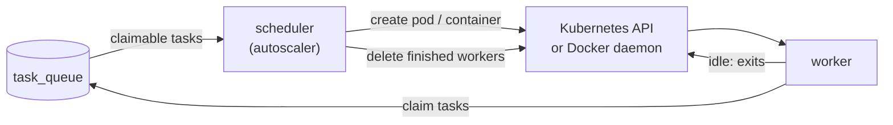

Task workers pick up queued work (OpenTofu plans and applies, syncs, scheduler jobs) from the PostgreSQL task queue.
Besides static workers that run all the time, InfraKitchen can start workers **on demand** when tasks are waiting
and remove them once they are idle, so you only pay for workers while they run.

On-demand workers are defined by **worker templates** (**Admin → Worker Templates**). A template has:

- **Provider** – where workers are started: **Kubernetes** (a pod per worker) or **Docker** (a container per worker).
  The provider interface (`application/worker_templates/providers`) is designed so more backends can be added.
- **Configuration** – provider specific. For Kubernetes it is a Pod manifest (YAML) and an optional namespace;
  for Docker it is the daemon address, image, command, network, environment, volumes and resource limits.
- **Max workers** – how many workers from this template may run at the same time.
- **Idle timeout** – a worker exits after being idle this long while no task is waiting.
- **Priority** – templates with a higher priority are used first; the next template is used once one is full.

On-demand workers share the queue with static workers, so you can keep a small static pool and let
templates absorb bursts, or run on-demand workers only.

## How it works



1. The scheduler always runs the autoscaler, every `WORKER_AUTOSCALER_INTERVAL_SECONDS` and shortly after new tasks
   are queued. It only acts on enabled worker templates, so without any it does nothing.
2. It counts the tasks a worker could take right now (tasks of the same entity run one at a time),
   subtracts free workers and workers that are still starting, and spawns the difference from enabled templates,
   up to each template's **max workers**.
3. A spawned worker runs tasks like any other worker. It registers with the template's name, so the
   **Workers** page shows where it came from. Once it was idle for the template's idle timeout and
   no task is waiting, it exits.
4. On the next pass the autoscaler deletes workers that exited normally, together with their worker records.

### Failures

- A worker that **fails** (non-zero exit, `OOMKilled`, an image that cannot be pulled, a missing Secret, ...) is
  reported in the template's **last error** and kept for `WORKER_FAILED_RETENTION_SECONDS`, so its logs can still be
  read (`kubectl logs` / `docker logs`). It does not count against **max workers** and is deleted afterwards.
- A worker that does not start within `WORKER_START_TIMEOUT_SECONDS` (e.g. an unschedulable pod) is deleted and
  reported the same way. Image pull and container configuration errors are detected right away.
- After a spawn error or a failed worker the template is **backed off**: no new workers are spawned from it for 30
  seconds, doubling up to 10 minutes. Meanwhile waiting tasks go to the next template by priority. The back-off and
  the error are cleared as soon as one of the template's workers registers.

The **Instances** tab lists the template's workers with their state and the task each one is running.

## Kubernetes provider

The autoscaler runs in the scheduler, and the backend lists workers and validates templates. Both use their pod's
ServiceAccount (in-cluster configuration), so they must run inside the cluster where workers are started.

<Steps>

<Step title="Grant the scheduler access to pods">

```yaml
apiVersion: rbac.authorization.k8s.io/v1
kind: Role
metadata:
  name: infrakitchen-worker-manager
  namespace: infrakitchen
rules:
  - apiGroups: [""]
    resources: ["pods"]
    verbs: ["get", "list", "create", "delete"]
---
apiVersion: rbac.authorization.k8s.io/v1
kind: RoleBinding
metadata:
  name: infrakitchen-worker-manager
  namespace: infrakitchen
subjects:
  - kind: ServiceAccount
    name: <SERVICE_ACCOUNT_NAME>
    namespace: infrakitchen
roleRef:
  kind: Role
  name: infrakitchen-worker-manager
  apiGroup: rbac.authorization.k8s.io
```

Bind it to the ServiceAccount of the scheduler and the backend. The Role must exist in the InfraKitchen
namespace (`get` lets InfraKitchen read its own pod) and in every namespace that templates spawn workers into.

</Step>

<Step title="Create a worker template">

Open **Admin → Worker Templates → Create**. The pod manifest is prefilled with a default worker pod;
adjust resources, the ServiceAccount, node selectors, tolerations and so on. Use **Validate** on the template
page to dry-run the pod against the Kubernetes API.

</Step>

</Steps>

#### Inherited settings

The worker container (the first container of the manifest) inherits InfraKitchen's configuration, so database
hosts, passwords and keys are never written into templates:

- its `image`, when the manifest sets none,
- the `env` and `envFrom` entries of the InfraKitchen container (the one with `POSTGRES_HOST`, else the first),
  except `WORKER_AUTOSCALER_*` and the variables set per worker.

They are read from the pod spec of the InfraKitchen pod itself, so secrets are copied as `secretKeyRef` /
`secretRef` references and their values never leave Kubernetes. Variables set in the template take precedence.
When workers run in another namespace, the referenced Secrets and ConfigMaps must exist there too.

#### Manifest changes

InfraKitchen changes the manifest before creating the pod:

- `metadata.name` is replaced by `generateName: ik-worker-<template-name>-` (`metadata.namespace` and `spec.hostname` are removed),
- the labels `app.kubernetes.io/managed-by: infrakitchen` and `infrakitchen.io/worker-template: <template id>` are added,
- `restartPolicy` is set to `Never`,
- `WORKER_IDLE_EXIT_SECONDS`, `WORKER_TEMPLATE_ID` and `WORKER_NAME` are set on every container.

## Docker provider

Workers are started as containers on a Docker host. The scheduler (which spawns workers) and the backend (which
lists and validates them) talk to the Docker daemon set in the template, by default the local socket
`unix:///var/run/docker.sock`. Mount it into both containers:

```yaml
services:
  python-backend-server:
    volumes:
      - /var/run/docker.sock:/var/run/docker.sock
```

> **Warning:** access to the Docker socket is equivalent to root access on the host. Only administrators can manage
> worker templates, but whoever can edit a template can run any container on that host.

A `tcp://host:2375` or `http(s)://` daemon address works too, e.g. a socket proxy that only allows the container
endpoints. TLS client certificates are not supported.

#### Inherited settings

When InfraKitchen itself runs in a container on the same Docker host, a worker container inherits from it:

- the **image**, when the template sets none,
- the **environment** (database, keys, ...), except `HOSTNAME`, `HOME`, `PATH`, `WORKER_*` set per worker and
  `WORKER_AUTOSCALER_*`; variables set in the template take precedence,
- the first **network**, when the template sets none, so the worker reaches the database the same way.

Outside a container, set the image in the template and pass the database settings as environment variables.
A missing image is pulled on the first spawn (public registries, or registries the daemon is already logged into).

#### Container settings

InfraKitchen names containers `ik-worker-<template-name>-<random>`, uses the name as hostname, labels them with
`app.kubernetes.io/managed-by: infrakitchen` and `infrakitchen.io/worker-template: <template id>`, and sets the
restart policy to `no`. **Validate** on the template page checks that the daemon answers and the network exists.

## Settings

| Variable | Default | Used by | Description |
| --- | --- | --- | --- |
| `WORKER_AUTOSCALER_INTERVAL_SECONDS` | `15` | scheduler | How often the autoscaler runs |
| `WORKER_START_TIMEOUT_SECONDS` | `600` | scheduler | Delete workers still pending after this long |
| `WORKER_FAILED_RETENTION_SECONDS` | `3600` | scheduler | Keep failed workers this long for their logs |
| `WORKER_IDLE_EXIT_SECONDS` | `0` | worker | Exit after this long without work and with an empty queue; `0` never exits. Set by templates |
| `WORKER_NAME` | `task_worker` | worker | Name the worker registers with; on-demand workers use the template name |

To remove a template, **disable** it first: no new workers are spawned from it, and the existing ones finish their
tasks, exit after the idle timeout and are cleaned up. The template can be deleted once it has no running workers;
failed workers kept for their logs are deleted with it.
