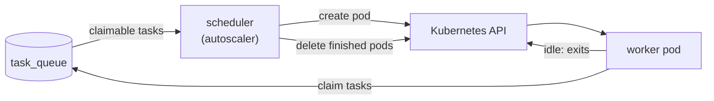

Task workers pick up queued work (OpenTofu plans and applies, syncs, scheduler jobs) from the PostgreSQL task queue.
Besides static workers that run all the time, InfraKitchen can start workers **on demand** when tasks are waiting
and remove them once they are idle, so you only pay for workers while they run.

On-demand workers are defined by **worker templates** (**Admin → Worker Templates**). A template has:

- **Provider** – where workers are started. Kubernetes is currently supported; the provider interface
  (`application/worker_templates/providers`) is designed so more backends can be added.
- **Configuration** – provider specific. For Kubernetes it is a Pod manifest (YAML) and an optional namespace.
- **Max workers** – how many workers from this template may run at the same time.
- **Idle timeout** – a worker exits after being idle this long while no task is waiting.
- **Priority** – templates with a higher priority are used first; the next template is used once one is full.

On-demand workers share the queue with static workers, so you can keep a small static pool and let
templates absorb bursts, or run on-demand workers only.

## How it works



1. The scheduler runs the autoscaler every `WORKER_AUTOSCALER_INTERVAL_SECONDS` and shortly after new tasks are queued.
2. It counts the tasks a worker could take right now (tasks of the same entity run one at a time),
   subtracts free workers and workers that are still starting, and spawns the difference from enabled templates,
   up to each template's **max workers**.
3. A spawned worker runs tasks like any other worker. Once it was idle for the template's idle timeout and
   no task is waiting, it exits; the pod ends in `Succeeded`.
4. On the next pass the autoscaler deletes finished pods (and pods stuck in `Pending` longer than
   `WORKER_START_TIMEOUT_SECONDS`, e.g. because of an image pull error) together with their worker records.

Spawn errors are shown on the worker template. The **Instances** tab lists the template's current workers.

## Kubernetes setup

The autoscaler runs in the scheduler, and the backend lists workers and validates templates. Both use their pod's
ServiceAccount (in-cluster configuration), so they must run inside the cluster where workers are started.

<Steps>

<Step title="Grant the scheduler access to pods">

```yaml
apiVersion: rbac.authorization.k8s.io/v1
kind: Role
metadata:
  name: infrakitchen-worker-manager
  namespace: infrakitchen
rules:
  - apiGroups: [""]
    resources: ["pods"]
    verbs: ["get", "list", "create", "delete"]
---
apiVersion: rbac.authorization.k8s.io/v1
kind: RoleBinding
metadata:
  name: infrakitchen-worker-manager
  namespace: infrakitchen
subjects:
  - kind: ServiceAccount
    name: <SERVICE_ACCOUNT_NAME>
    namespace: infrakitchen
roleRef:
  kind: Role
  name: infrakitchen-worker-manager
  apiGroup: rbac.authorization.k8s.io
```

Bind it to the ServiceAccount of the scheduler and the backend. The Role must exist in the InfraKitchen
namespace (`get` lets InfraKitchen read its own pod) and in every namespace that templates spawn workers into.

</Step>

<Step title="Enable the autoscaler">

Set `WORKER_AUTOSCALER_ENABLED=true` on the scheduler.

</Step>

<Step title="Create a worker template">

Open **Admin → Worker Templates → Create**. The pod manifest is prefilled with a default worker pod;
adjust resources, the ServiceAccount, node selectors, tolerations and so on. Use **Validate** on the template
page to dry-run the pod against the Kubernetes API.

</Step>

</Steps>

### Inherited settings

The worker container (the first container of the manifest) inherits InfraKitchen's configuration, so database
hosts, passwords and keys are never written into templates:

- its `image`, when the manifest sets none,
- the `env` and `envFrom` entries of the InfraKitchen container (the one with `POSTGRES_HOST`, else the first),
  except `WORKER_AUTOSCALER_*` and the variables set per worker.

They are read from the pod spec of the InfraKitchen pod itself, so secrets are copied as `secretKeyRef` /
`secretRef` references and their values never leave Kubernetes. Variables set in the template take precedence.
When workers run in another namespace, the referenced Secrets and ConfigMaps must exist there too.

### Manifest changes

InfraKitchen changes the manifest before creating the pod:

- `metadata.name` is replaced by `generateName: ik-worker-<template-name>-` (`metadata.namespace` and `spec.hostname` are removed),
- the labels `app.kubernetes.io/managed-by: infrakitchen` and `infrakitchen.io/worker-template: <template id>` are added,
- `restartPolicy` is set to `Never`,
- `WORKER_IDLE_EXIT_SECONDS`, `WORKER_TEMPLATE_ID` and `WORKER_NAME` are set on every container.

## Settings

| Variable | Default | Used by | Description |
| --- | --- | --- | --- |
| `WORKER_AUTOSCALER_ENABLED` | `false` | scheduler | Spawn and clean up on-demand workers |
| `WORKER_AUTOSCALER_INTERVAL_SECONDS` | `15` | scheduler | How often the autoscaler runs |
| `WORKER_START_TIMEOUT_SECONDS` | `600` | scheduler | Delete workers still pending after this long |
| `WORKER_IDLE_EXIT_SECONDS` | `0` | worker | Exit after this long without work and with an empty queue; `0` never exits. Set by templates |
| `WORKER_NAME` | `task_worker` | worker | Name the worker registers with |

Deleting a template does not remove its running workers; they finish their tasks and exit after the idle timeout.
Disable a template first to stop new workers from being spawned; existing ones are still cleaned up.
